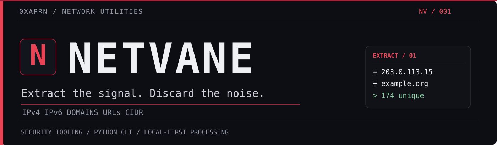
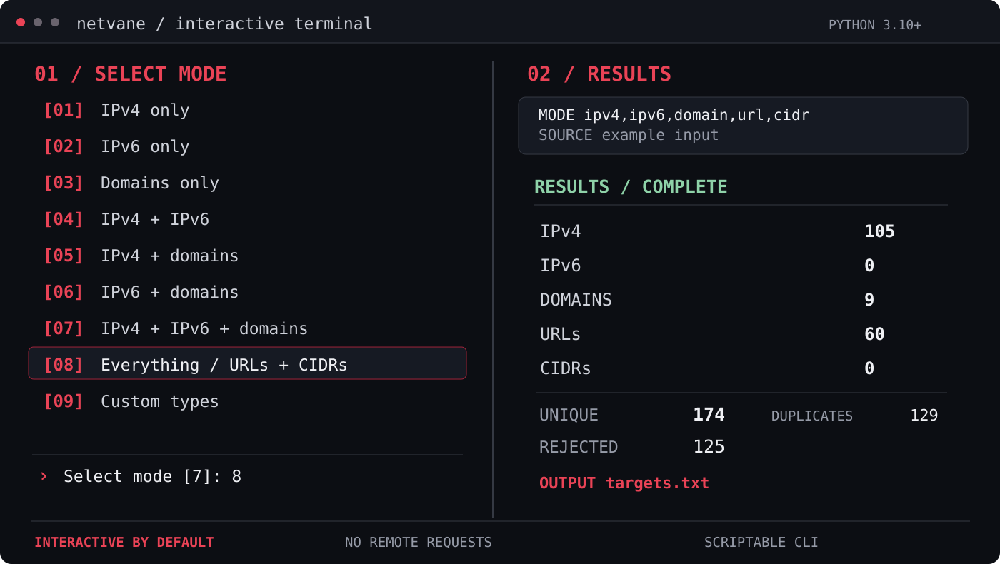

<div align="center">



<br/>

<a href="#installation"></a>&nbsp;
<a href="#testing"></a>&nbsp;
<a href="#features"></a>&nbsp;
<a href="LICENSE"></a>

<br/>
<br/>

**A focused Python terminal utility for turning noisy text into clean network indicators.**

Extract IPv4, IPv6, domains, URLs and CIDRs from pasted text, logs and structured files.  
Validate, normalize, filter, deduplicate and export — without installing a scanner.

[**Install**](#installation) · [**See the CLI**](#the-terminal) · [**Modes**](#extraction-modes) · [**Examples**](#examples) · [**Options**](#reference)

</div>

---

## The terminal

Launch `netvane` without arguments. Select your extraction mode, choose an input file or paste text, adjust cleanup settings, and pick the destination filename.

<div align="center">
  
  <sub>Vector-rendered walkthrough based on the CLI. Actual colors inherit your terminal and only appear when supported.</sub>
</div>

<br/>

> [!TIP]
> Run it interactively for one-off cleanup, or pass flags for reproducible scripts and pipelines. The normal CLI doesn't require an interactive session.

## Installation

**Python 3.10+ · Linux / macOS / Windows (direct runner) · No third-party runtime dependencies**

### Try it without installing

```bash
git clone https://github.com/0xaprn/Netvane.git
cd Netvane
python3 run.py
```

### Install the `netvane` command (Linux / macOS)

```bash
python3 install.py
netvane
```

The optional user-local installer copies the Python package to `~/.local/share/netvane` and creates the executable `~/.local/bin/netvane`. No `sudo`, `pip`, wheel download or global Python modification needed. If your shell cannot find the command, add the directory to your `PATH`:

```bash
export PATH="$HOME/.local/bin:$PATH"
```

To refresh a user-local installation from a newer checkout, run `python3 install.py --force`. On Windows, use `python3 run.py`.

## Extraction modes

| Selection | Indicators | Use case |
|:--:|---|---|
| `01` | **IPv4** | IPv4 addresses only |
| `02` | **IPv6** | IPv6 addresses only |
| `03` | **Domains** | Domain and hostname lists |
| `04` | **IPv4 + IPv6** | Mixed-address input |
| `05` | **IPv4 + domains** | Common target-list cleanup |
| `06` | **IPv6 + domains** | IPv6-heavy inventories |
| `07` | **IPv4 + IPv6 + domains** | Host indicators (default) |
| `08` | **Everything** | Include URLs and CIDR blocks |
| `09` | **Custom** | Select exactly the desired types |

The wizard also prompts for defanged-text decoding, port removal, non-global IP filtering, sorting, output names, overwrite confirmation and optional advanced settings.

## Features

<table>
<tr><td width="50%" valign="top">

**01 / Recognize**

IPv4 · IPv6 · IDN hostnames · HTTP(S) URLs · IPv4/IPv6 CIDRs

**02 / Clean**

Defanged indicator decoding, port validation, normalization and ambiguity handling

**03 / Filter**

Type selection, global-IP filtering, inclusion scopes and exclusion rules

</td><td width="50%" valign="top">

**04 / Import**

Text · CSV · TSV · JSON · JSONL · gzip · standard input

**05 / Trace**

Source details, rejected candidates, duplicate information and JSONL audit

**06 / Export**

TXT · CSV · JSONL · split output files · in-memory or SQLite deduplication

</td></tr>
</table>

## Examples

### Pull IPv4s and domains from a log

```bash
netvane examples/messy.log --fang --types ipv4,domain -o targets.txt
```

### Extract each indicator type separately

```bash
netvane examples/messy.log --types ipv4 -o ipv4.txt
netvane examples/messy.log --types ipv6 -o ipv6.txt
netvane examples/messy.log --types domain -o domains.txt
```

### Keep URLs, strip ports, write an audit

```bash
netvane examples/messy.log --types ipv4,domain,url --fang \
  --strip-ports --audit audit.jsonl -o targets.txt
```

### Filter to a defined asset scope

```bash
netvane examples/messy.log --scope examples/scope.txt -o scoped.txt
```

### Pipe into another command

```bash
cat examples/messy.log | netvane --types ipv4,domain -o - --quiet
```

### Export structured findings

```bash
netvane examples/findings.csv --field target --format jsonl -o findings.jsonl
```

> [!IMPORTANT]
> Netvane processes supplied data; it does **not** scan hosts, resolve DNS, contact URLs, or check whether extracted targets are live. Existing output files require confirmation in the menu or an explicit `--force` flag.

## Reference

<details>
<summary><strong>Input and export options</strong></summary>

| Flag | Action |
|---|---|
| `FILE ...` | Read files, or use `-`/stdin |
| `--wizard` | Open the guided terminal menu |
| `--types ipv4,ipv6,domain,url,cidr` | Choose indicators |
| `-o`, `--output PATH` | Combined output, `-` for stdout |
| `--force` | Allow overwriting an existing output |
| `--input-format` | `auto`, `text`, `csv`, `tsv`, `json`, `jsonl` |
| `--field KEY` | Select structured-data fields; repeatable |
| `--format` | `lines`, `csv`, `jsonl` |
| `--ips-out`, `--domains-out` | Separate IP and domain lists |
| `--urls-out`, `--cidrs-out` | Separate URL and network lists |
| `--audit`, `--rejects-out` | JSONL audit and rejection output |
| `--stats-json` | Export extraction statistics |

</details>

<details>
<summary><strong>Parsing, filtering and display options</strong></summary>

| Flag | Action |
|---|---|
| `--fang` | Decode common defanged indicators |
| `--keep-urls` | Preserve full HTTP(S) URLs |
| `--cidr` | Recognize CIDR ranges |
| `--strip-ports` | Normalize to host-only values |
| `--include-ambiguous` | Keep filename-like domains |
| `--public-only` | Filter non-global IP and network literals |
| `--scope`, `--exclude` | Include and exclude by scope file |
| `--dedupe memory|sqlite` | Select the deduplication backend |
| `--sort` | Sort results (additional memory required) |
| `--max-line-chars N` | Set field-length cap; `0` disables |
| `--ui auto|always|never` | Control visual terminal status |
| `--no-color`, `--quiet` | Control terminal output |
| `--version`, `--help` | Show version/help |

</details>

<details>
<summary><strong>Input normalization, scope rules and scaling</strong></summary>

A scope list supports domains, exact hosts, subdomain patterns and CIDR ranges:

```text
example.org
*.example.net
=portal.example.com
192.0.2.0/24
2001:db8::/32
```

Hostnames are normalized to lowercase/IDNA, IP addresses and networks to canonical forms, and ports validated. Text, CSV, TSV and JSONL support incremental input processing. Full JSON documents and sorted outputs can require substantial memory. `--dedupe sqlite` provides disk-backed uniqueness tracking for larger datasets.

Scope matching does not prove ownership of a host or authorization to access it. No DNS lookups are performed.

</details>

## Security

Netvane is a **local parser**, not an active scanner. It does not launch shell commands, follow extracted URLs or send telemetry. Treat input and output as potentially sensitive: query strings, audit logs and original matches may contain credentials or other secrets. Review generated outputs before sharing.

See [SECURITY.md](SECURITY.md) for responsible reporting and known limitations.

## Testing

```bash
PYTHONPATH=src python3 -m unittest discover -s tests -v
python3 -m compileall -q src
python3 run.py --help
```

The [GitHub Actions workflow](.github/workflows/tests.yml) runs unit tests on Python 3.10–3.13. The badge above reflects 54 locally passing tests in this release; it is **not** a live CI status indicator.

<details>
<summary><strong>Repository layout</strong></summary>

```text
Netvane/
├── .github/workflows/   Automated tests
├── assets/              Vector artwork and social preview
├── examples/            Sample input
├── src/netvane/         Extraction engine and terminal UI
├── tests/               Unit tests
├── run.py               Direct launcher
├── install.py           User-local installer
├── pyproject.toml       Package metadata
├── README.md
├── CHANGELOG.md
├── SECURITY.md
└── LICENSE
```

</details>

---

<div align="center">

**NETVANE** / EXTRACT THE SIGNAL. DISCARD THE NOISE.

<sub>Created by <a href="https://github.com/0xaprn">0xaprn</a> · <a href="LICENSE">MIT</a> · <a href="CHANGELOG.md">Changelog</a></sub>

</div>
