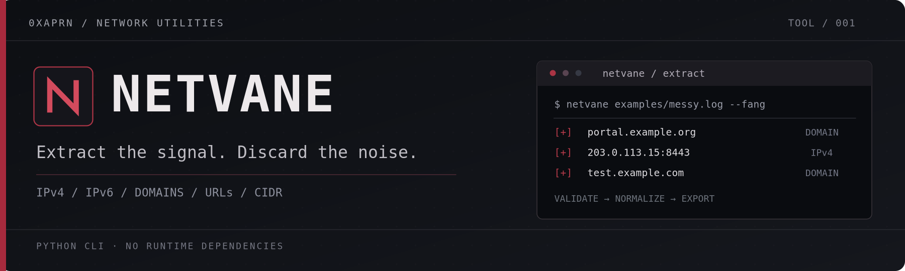
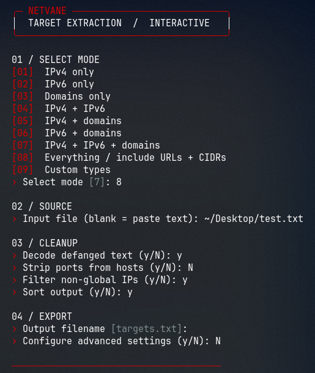
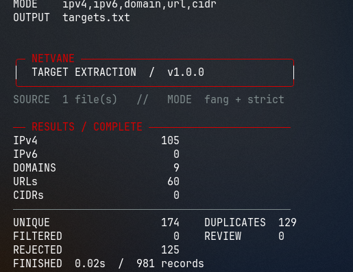

<p align="center">
  
</p>

<p align="center">
  
  
  
  <a href="LICENSE"></a>
</p>

<p align="center">
  <strong>Find the targets. Leave the noise.</strong><br>
  Extract, validate, normalize and export IP addresses, domains, URLs and network ranges<br>
  from pasted text, logs and structured files — with a focused interactive CLI.
</p>

<p align="center">
  <a href="#quick-start">Quick start</a> &nbsp;·&nbsp;
  <a href="#live-terminal">Terminal</a> &nbsp;·&nbsp;
  <a href="#capabilities">Capabilities</a> &nbsp;·&nbsp;
  <a href="#examples">Examples</a> &nbsp;·&nbsp;
  <a href="#cli-reference">CLI reference</a> &nbsp;·&nbsp;
  <a href="#security--scope">Security</a>
</p>

---

## Live terminal

The interface below is **actual Netvane output**, captured during an extraction run. The CLI inherits your terminal's background and adds restrained red highlights; it does not install a theme.

<table>
<tr>
<td width="54%" align="center" valign="top">
  <strong>01 — Configure</strong><br><br>
  
</td>
<td width="46%" align="center" valign="top">
  <strong>02 — Results</strong><br><br>
  
</td>
</tr>
</table>

> **Interactive by default.** Run `netvane` without arguments to choose your extraction mode, provide input, adjust cleanup settings and select the output filename. Supply flags to use it non-interactively in scripts and pipelines.

## Quick start

**Requires Python 3.10 or newer. No third-party runtime packages.**

```bash
git clone https://github.com/0xaprn/Netvane.git
cd Netvane
python3 run.py
```

Install the `netvane` command for your user account on Linux or macOS:

```bash
python3 install.py
netvane
```

The installer copies the package to `~/.local/share/netvane` and creates `~/.local/bin/netvane`. It does not require `sudo`, `pip` or a downloaded wheel. If your shell does not find `netvane`, add `~/.local/bin` to your `PATH` and reopen your terminal:

```bash
export PATH="$HOME/.local/bin:$PATH"
```

To update a copy installed by this script, run `python3 install.py --force` from the updated checkout. On Windows, use `python3 run.py` or a standard Python virtual environment.

## Capabilities

| | Feature | What it does |
|:--:|---|---|
| `01` | **IP extraction** | Validates IPv4 and IPv6, including canonical formatting and optional port removal |
| `02` | **Domain + URL extraction** | Extracts hostnames, internationalized domains and optionally full HTTP(S) URLs |
| `03` | **Networks** | Parses IPv4/IPv6 CIDRs when requested |
| `04` | **Messy inputs** | Reads pasted text, logs, CSV, TSV, JSON, JSONL and gzip files |
| `05` | **Normalization** | Handles defanged indicators, validates ports and deduplicates normalized results |
| `06` | **Filtering** | Selects indicator types; filters non-global literals or applies explicit scope rules |
| `07` | **Evidence trail** | Records source, original match, duplicates and rejected or ambiguous candidates |
| `08` | **Export + scale** | Writes TXT, CSV or JSONL; supports split files and SQLite-backed deduplication |

## Examples

### From noisy input to targets

```text
[200] https://portal.example.org/login
[403] 203.0.113.15:8443
[INFO] hxxps://test[.]example[.]com
[WARN] report.pdf
[ERR] 999.1.2.3
```

```bash
netvane examples/messy.log --fang --types ipv4,domain \
  --audit audit.jsonl -o targets.txt
```

The extracted host indicators are `portal.example.org`, `203.0.113.15:8443` and `test.example.com`. The optional audit distinguishes ambiguous `report.pdf` from invalid `999.1.2.3`. Documentation-range IPs are excluded when `--public-only` is enabled.

### Ready-to-use commands

```bash
# IPv4 only, IPv6 only, or domains only
netvane examples/messy.log --types ipv4 -o ipv4.txt
netvane examples/messy.log --types ipv6 -o ipv6.txt
netvane examples/messy.log --types domain -o domains.txt

# Combined hosts with ports removed
netvane examples/messy.log --types ipv4,ipv6,domain --strip-ports -o hosts.txt

# Extract full URLs and defanged hostnames
netvane examples/messy.log --fang --types domain,url -o indicators.txt

# Separate exports with an evidence trail
netvane examples/messy.log --ips-out ips.txt --domains-out domains.txt \
  --audit audit.jsonl -o targets.txt

# Read selected fields from structured records
netvane examples/findings.csv --field target --format jsonl -o findings.jsonl
netvane examples/events.jsonl --field url --field host -o events-targets.txt

# Restrict extracted indicators to a scope file
netvane examples/messy.log --scope examples/scope.txt -o scoped.txt

# Use SQLite-backed deduplication for larger datasets
netvane examples/messy.log --dedupe sqlite -o targets.txt

# Print results without the interactive UI or status text
cat examples/messy.log | netvane --types ipv4,domain -o - --quiet
```

> **Output protection:** Existing output files require explicit `--force` or confirmation in the interactive menu. Review generated target lists, URLs and audit records before sharing them; they can contain sensitive strings.

## CLI reference

Run `netvane --help` for built-in help. The main command-line options are documented below.

<details>
<summary><strong>Inputs and output formats</strong></summary>

| Option | Purpose |
|---|---|
| `FILE ...` | One or more input files; use `-` or omit the file for stdin |
| `--wizard` | Explicitly open the guided interactive menu |
| `--types ipv4,ipv6,domain,url,cidr` | Select indicator types |
| `-o`, `--output PATH` | Combined results; `-` writes to stdout (default `targets.txt`) |
| `-f`, `--force` | Allow replacing existing output files |
| `--input-format` | `auto`, `text`, `csv`, `tsv`, `json`, `jsonl` |
| `--field KEY` | Select a CSV column or JSON key; repeatable |
| `--format` | `lines`, `csv`, or `jsonl` |
| `--ips-out PATH` | Write an IP-only list |
| `--domains-out PATH` | Write a domain-only list |
| `--urls-out PATH` | Write full URLs; URL extraction must be enabled |
| `--cidrs-out PATH` | Write CIDR ranges; CIDR extraction must be enabled |
| `--audit PATH` | Write a JSONL event audit |
| `--rejects-out PATH` | Write rejected and ambiguous candidates as JSONL |
| `--stats-json PATH` | Write machine-readable extraction statistics |

</details>

<details>
<summary><strong>Parsing, filtering and performance</strong></summary>

| Option | Purpose |
|---|---|
| `--fang` | Decode defanged URL and hostname forms |
| `--keep-urls` | Retain full HTTP(S) URLs alongside hosts |
| `--cidr` | Enable network-range extraction |
| `--strip-ports` | Remove ports from hosts and IPs |
| `--include-ambiguous` | Include filename-like strings that could be domains |
| `--public-only` | Exclude non-global IP/network literals, without DNS resolution |
| `--scope PATH` | Include indicators matching a scope file |
| `--exclude PATH` | Exclude indicators matching a scope file |
| `--dedupe memory|sqlite` | Select in-memory or disk-backed uniqueness tracking |
| `--sort` | Sort results (uses extra memory) |
| `--max-line-chars N` | Skip oversized input fields (default: 1,000,000; 0 disables) |
| `--ui auto|always|never` | Control terminal status output |
| `--no-color` | Disable ANSI color; also respects `NO_COLOR=1` |
| `-q`, `--quiet` | Suppress informational messages |
| `--help`, `--version` | Show help and version |

</details>

<details>
<summary><strong>Scopes, normalization and source tracking</strong></summary>

**Scope file syntax:**

```text
example.org          # root domain and subdomains
*.example.net        # subdomains only
=portal.example.com  # exact host
192.0.2.0/24         # IPv4 range
2001:db8::/32        # IPv6 range
```

- Domains are lowercased and IDNA-normalized. IPs and networks use canonical forms; ports are validated.
- The first-seen order is preserved unless `--sort` is enabled. Duplicates are keyed by indicator type and normalized value.
- Text, CSV, TSV and JSONL are processed incrementally. Full JSON documents load in memory.
- Audit exports can track accepted, duplicate, filtered and rejected candidates along with source details.
- A scope rule does not establish asset ownership or authorization; filtering uses literal IPs, networks and domains without DNS queries.

</details>

## Security & scope

Netvane **parses supplied files**. It does not probe networks, resolve domains, follow URLs, execute extracted content, run shell commands or send telemetry. It can process data collected from online sources, but extraction itself makes no outbound requests.

- **No silent overwrite.** Existing output requires explicit authorization; final-component output symlinks are rejected.
- **Potentially sensitive exports.** Full URLs and audits may include tokens, paths, passwords or query strings. Treat exports as data that may need redaction.
- **Heuristic parsing.** A valid-looking hostname may not exist, and filename-like strings can be ambiguous. It is not a live scanner or validator of domain ownership.
- **Resource limits.** Full JSON files and sorted output can require substantial memory. Interrupted jobs may leave partial output files.

Read the [security policy](SECURITY.md) for reporting guidance and additional limitations.

## Development

```bash
PYTHONPATH=src python3 -m unittest discover -s tests -v
python3 -m compileall -q src
python3 run.py --help
```

The repository also includes a [GitHub Actions workflow](.github/workflows/tests.yml) to test Python 3.10, 3.11, 3.12 and 3.13 on supported runners.

<details>
<summary><strong>Project structure</strong></summary>

```text
Netvane/
├── .github/workflows/   Automated test workflow
├── assets/              Banner, badges and terminal captures
├── examples/            Sanitized sample input
├── src/netvane/         Parser, filters, CLI and terminal UI
├── tests/               Standard-library unit tests
├── run.py               Run without installing
├── install.py           User-local command installer
├── pyproject.toml       Package metadata and CLI entry point
├── README.md
├── SECURITY.md
├── CHANGELOG.md
└── LICENSE
```

</details>

---

<p align="center">
  <strong>NETVANE</strong> &nbsp; / &nbsp; EXTRACT THE SIGNAL. DISCARD THE NOISE.<br>
  <sub>Maintained by <a href="https://github.com/0xaprn">0xaprn</a> · <a href="LICENSE">MIT License</a> · <a href="CHANGELOG.md">Changelog</a></sub>
</p>
